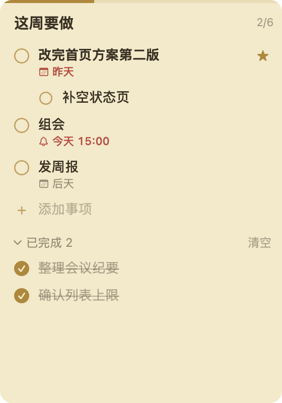
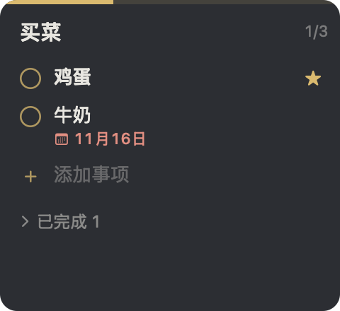

# 便笺清单

Mac 桌面上的待办便笺。一行一条，点圆圈勾掉，比系统自带的「便笺」好记事。

<p>


</p>

## 下载

到 [Releases](../../releases) 下载 `便笺清单.dmg`，打开后把图标拖进「应用程序」。

应用没有做苹果公证，第一次打开会提示「无法验证开发者」：在「应用程序」里右键它 → 打开，再点一次「打开」就行。也可以去「系统设置 → 隐私与安全性」底部点「仍要打开」。

需要 macOS 14 或更新版本，Apple 芯片和 Intel 都能用。

## 能做什么

- 打字回车就加一条，粘贴多行文字会自动拆成多条
- 勾掉的事收进「已完成」，顶部细条显示完成进度
- 直接写「明天」「周五 3点」「下周一 10:30」「11月25日」，自动变成截止时间，到点发系统通知；过期标红
- 鼠标移到一条上：☆ 标为重要并排到最上面，日历按钮设截止时间，≡ 拖动排序
- Tab 缩进成子任务，⇧Tab 退回；勾掉主事项时子任务一起勾掉
- 删错了底部有「撤回」；删掉的整张便笺在菜单栏「最近删除的便笺」里能找回
- 「已完成记录」（⌘Y）按天列出做完的事，可搜索，一键复制成日报
- 6 种纸色，可开磨砂玻璃、调不透明度；可以置顶、双击顶部收起成一行
- 菜单栏图标里能设开机自动打开，还能从系统「便笺」导入

## 快捷键

| 按键 | 作用 |
| --- | --- |
| ⌘N | 新建便笺 |
| 回车 | 新起一条 |
| ⌥↑ / ⌥↓ | 调整顺序 |
| Tab / ⇧Tab | 缩进成子任务 / 退回 |
| 空行按删除键 | 删掉这一行 |
| ⌘Y | 已完成记录 |
| ⌘W | 删除当前便笺 |

## 数据放在哪

`~/Library/Application Support/便笺清单/`

- `notes.json`：所有便笺
- `notes.backup.json`：上次打开时的备份
- `history.json`：已完成记录
- `trash.json`：最近删除的便笺

## 自己编译

装好 Xcode 命令行工具后运行：

```sh
./build.sh
```

产物在 `build/` 里：`便笺清单.app`、`.dmg` 和 `.zip`。
